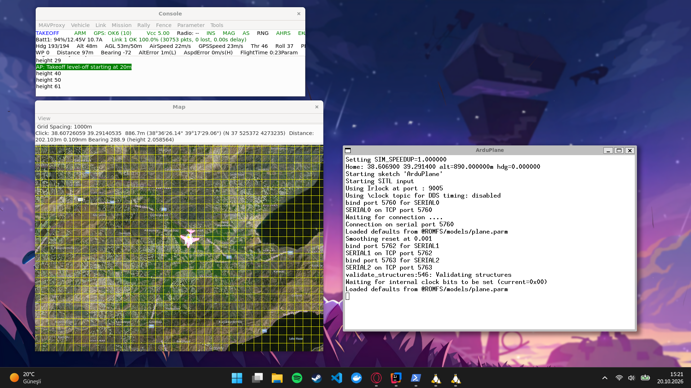

# OTONOM-C3

**Sabit kanatlı İHA filoları için gerçek zamanlı Komuta, Kontrol ve Haberleşme (C3) sistemi**

Fırat Üniversitesi Yazılım Mühendisliği bitirme projesi · 2026–2027

> 🚧 Proje geliştirme aşamasındadır.

## Proje hakkında

OTONOM-C3, 10 İHA'lık bir filoyu gerçek otopilot yazılımı (ArduPlane SITL) ve gerçek MAVLink protokolü üzerinden izleyen bir C3 sistemidir. Sistem; telemetriyi gerçek zamanlı işler, yakıt, irtifa, yasaklı bölge ve arıza gibi anomalileri tespit eder ve operatöre insan onaylı otonom kararlar (örneğin yeni rota önerisi) sunar.

Fiziksel İHA kullanılmaz. İHA'ları, gerçek İHA'larda çalışan ArduPilot otopilot yazılımının bilgisayarda çalışan hali (SITL) yönetir. Operasyon bölgesi Elazığ'dır.

## Ekran görüntüleri

**ArduPlane SITL: Elazığ Havalimanı üzerinde uçan İHA**



**Python ile canlı telemetri okuma**


**10 İHA'nın telemetrisinin tek scriptle eş zamanlı izlenmesi**


## Planlanan mimari

```
ArduPlane SITL ──► Kenar adaptörü ──► RabbitMQ ──► Spring Boot çekirdeği ──► 2D harita
 (MAVLink)         (Python)                        ├─ Kural motoru (anomali)
                                                   └─ PostgreSQL + PostGIS
```

## Teknolojiler

| Katman | Teknoloji |
| --- | --- |
| İHA simülasyonu | ArduPilot ArduPlane SITL |
| Kenar adaptörü | Python, pymavlink |
| Mesaj kuyruğu | RabbitMQ |
| Çekirdek | Java 21, Spring Boot |
| Veritabanı | PostgreSQL, PostGIS |
| Altyapı | Docker, WSL2 (Ubuntu) |

## Klasör yapısı

```
otonom-c3/
├── core/          Spring Boot çekirdeği
├── experiments/   İlk denemeler (SITL telemetri okuma)
└── docs/          Belgeler ve görseller
```

## Mevcut durum

- [x] Spring Boot proje iskeleti
- [x] ArduPlane SITL kurulumu, Elazığ üzerinde uçuş
- [x] pymavlink ile canlı telemetri okuma
- [x] 10 İHA'lık filonun eş zamanlı izlenmesi ve bağlantı kaybı tespiti
- [ ] Kenar adaptörü (MAVLink → JSON → RabbitMQ)
- [ ] Spring Boot ile telemetri işleme ve PostGIS'e kayıt
- [ ] Kural motoru ve alarm yönetimi
- [ ] 2D harita ekranı
- [ ] C3 haberleşme katmanı ve ileri özellikler
- [ ] 20 İHA ile ölçeklenebilirlik testi

## Deneyleri çalıştırma

Ubuntu (WSL) terminalinde SITL'i başlatın. Tek İHA için:

```bash
cd ~/ardupilot/ArduPlane
sim_vehicle.py -v ArduPlane --custom-location=38.6069,39.2914,890,0 --console --map
```

10 İHA'lık filo için:

```bash
sim_vehicle.py -v ArduPlane --count 10 --auto-sysid --custom-location=38.6069,39.2914,890,0 --auto-offset-line 90,30 --console --map
```

İkinci bir Ubuntu terminalinde telemetriyi okuyun:

```bash
source ~/venv-ardupilot/bin/activate
cd experiments
python3 read_telemetry.py   # tek İHA
python3 read_fleet.py       # filo (FLEET_SIZE ile ayarlanır)
```

## Akademik bilgi

- **Öğrenci:** Emirhan Uzen
- **Danışman:** Prof. Dr. Engin Avcı
- **Bölüm:** Fırat Üniversitesi, Yazılım Mühendisliği
